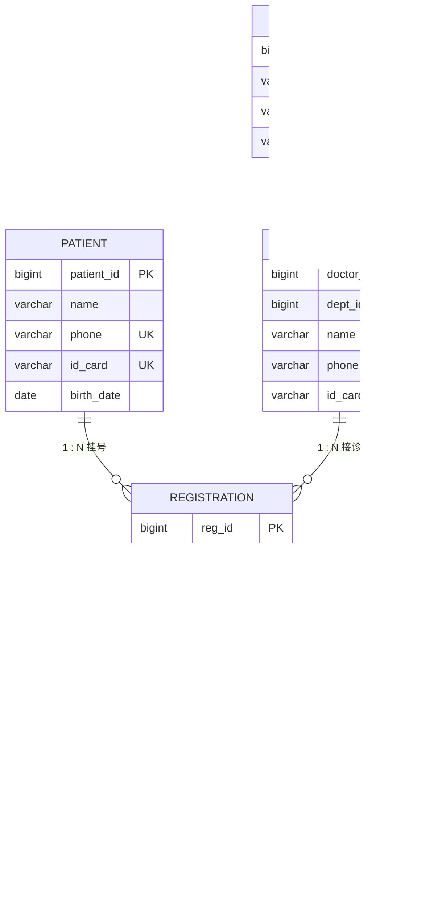

# 实验二：医疗系统数据库设计与基础 CRUD

## 一、实验目的与环境

**实验目的**：设计符合第三范式的医疗多实体数据库；使用 MyBatis-Plus 代码生成器一键生成持久层；实现科室、医生、患者的多条件组合分页查询与增删改；用 PreparedStatement 防止 SQL 注入；对手机号、身份证等医疗敏感字段做格式校验。

| 项目 | 版本 / 说明 |
| --- | --- |
| JDK | LibericaJDK 17 |
| Spring Boot | 3.2.0 |
| MyBatis-Plus | 3.5.12（starter / generator） |
| MySQL | 8.0.45，库 `medical_db` |
| 模板引擎 | velocity-engine-core 2.3（代码生成器） |
| 前端 | Vue 3 + Vite（5173，本实验不改动） |

## 二、数据库设计（第三范式）

### 2.1 实体关系图



### 2.2 表结构与约束

| 表 | 主键 | 非空 | 唯一 | 外键 |
| --- | --- | --- | --- | --- |
| `department` | `dept_id` (BIGINT AUTO_INCREMENT) | `dept_name`, `created_at`, `updated_at` | `dept_name` | — |
| `doctor` | `doctor_id` | `dept_id`, `name`, `gender`, `phone`, `id_card`, 时间戳 | `phone`, `id_card` | `dept_id → department.dept_id` |
| `patient` | `patient_id` | `name`, `gender`, `phone`, `id_card`, 时间戳 | `phone`, `id_card` | — |
| `registration` | `reg_id` | `patient_id`, `doctor_id`, `reg_time`, `status` | — | `patient_id → patient`, `doctor_id → doctor` |
| `prescription` | `pres_id` | `reg_id`, `diagnosis`, 时间戳 | — | `reg_id → registration` |

所有外键均为 `ON DELETE RESTRICT ON UPDATE CASCADE`，并为外键列建立普通索引以加速关联查询；时间戳用 `DEFAULT CURRENT_TIMESTAMP` 与 `ON UPDATE CURRENT_TIMESTAMP` 由数据库维护，避免应用层写错。

### 2.3 第三范式论证

- **1NF**：每个字段都是原子值（无数组、无逗号拼接的多值），每行由单列自增主键唯一标识，无重复组。
- **2NF**：全部表采用单列主键，非主属性不可能只依赖主键的一部分，因此完全函数依赖成立。
- **3NF**：消除非主属性对主键的传递依赖，本设计刻意去掉了三处常见冗余：
  1. `registration` **不存 `dept_id`**。科室可由 `doctor_id → doctor.dept_id → department` 推导；若同时存储，则 `reg_id → doctor_id → dept_id` 构成传递依赖，且换科室时两处数据可能不一致。
  2. `prescription` **不存 `patient_id` / `doctor_id`**。二者可由 `reg_id → registration` 推导，重复存储会造成更新异常。
  3. `department` **不存 `doctor_count` 等派生统计字段**，统计值由 `COUNT` 查询实时计算。

结论：5 张表无冗余字段，全部满足 3NF。完整可执行脚本见 `sql/medical_db.sql`（`CREATE DATABASE` + `DROP/CREATE TABLE` 顺序可重复执行，已在 MySQL 8.0 实测无报错）。

## 三、MyBatis-Plus 代码生成器

配置文件：`src/main/java/com/example/test1/generator/CodeGenerator.java`。

```java
FastAutoGenerator.create(url, username, password)
    .globalConfig(b -> b.author("student").outputDir(projectDir + "/src/main/java").commentDate(""))
    .packageConfig(b -> b.parent("com.example.test1")
        .entity("entity").mapper("mapper").service("service").serviceImpl("service.impl")
        .pathInfo(Collections.singletonMap(OutputFile.xml, projectDir + "/src/main/resources/mapper")))
    .strategyConfig(b -> {
        b.addInclude("department", "doctor", "patient", "registration", "prescription")
            .entityBuilder()
                .enableTableFieldAnnotation()
                .naming(NamingStrategy.underline_to_camel)
                .columnNaming(NamingStrategy.underline_to_camel);
        b.controllerBuilder().disable();
    })
    .execute();
```

运行命令（Maven exec 插件提供完整 classpath）：

```powershell
.\mvnw.cmd -q org.codehaus.mojo:exec-maven-plugin:3.3.0:java "-Dexec.mainClass=com.example.test1.generator.CodeGenerator"
```

一键生成 5 套 `entity` / `mapper` / `service` / `service.impl` 及 5 个 `Mapper.xml`。`controllerBuilder().disable()` 关闭了 Controller 生成，因为控制器要承载分页、参数校验、外键存在性判断等业务逻辑，不适合用通用模板生成。

`pathInfo(OutputFile.xml, ...)` 把 `Mapper.xml` 直接输出到 `src/main/resources/mapper/`，与 `mybatis-plus.mapper-locations=classpath:mapper/*.xml` 对齐，无需手工搬运；`IdType.AUTO` 与数据库自增主键一致。

说明：本环境使用的 MyBatis-Plus 3.5.12 为精简构建，未提供 `PaginationInnerInterceptor`，因此分页不依赖该插件，改由 Mapper 中显式的 `LIMIT #{offset}, #{size}` 预编译占位符实现，安全性与可控性更强。

## 四、CRUD 与多条件分页实现

### 4.1 接口清单（统一前缀 `/api`，统一响应 `R<T>`）

| 资源 | 分页（多条件） | 详情 | 新增 | 修改 | 删除 |
| --- | --- | --- | --- | --- | --- |
| 科室 | `GET /api/departments` | `GET /{id}` | `POST` | `PUT /{id}` | `DELETE /{id}` |
| 医生 | `GET /api/doctors` | `GET /{id}` | `POST` | `PUT /{id}` | `DELETE /{id}` |
| 患者 | `GET /api/patients` | `GET /{id}` | `POST` | `PUT /{id}` | `DELETE /{id}` |

科室条件：`deptName`(模糊)、`deptLocation`(模糊)、`deptPhone`(精确)；医生条件：`name`(模糊)、`title`(模糊)、`deptId`、`phone`、`idCard`、`gender`；患者条件：`name`(模糊)、`phone`、`idCard`、`gender`。

### 4.2 分页与预编译

分页采用「一次 COUNT + 一次 LIMIT 查询」，两次 SQL 的条件片段完全一致：

```sql
SELECT COUNT(*) FROM doctor
<where>
  <if test='name != null and name != ""'> AND name LIKE CONCAT('%', #{name}, '%')</if>
  <if test='deptId != null'> AND dept_id = #{deptId}</if>
  ...
</where>;

SELECT * FROM doctor <where>...</where>
ORDER BY doctor_id ASC LIMIT #{offset}, #{size};
```

`offset = (page - 1) * size`，由 `PageParam` 在服务端计算并校验 `page >= 1`、`1 <= size <= 100`，返回值封装为 `PageResult<T>`（`records / total / page / size / pages`）。

## 五、PreparedStatement 防 SQL 注入

- **机制**：MyBatis 的 `#{...}` 会被编译成 JDBC `?` 占位符，SQL 文本先由数据库预编译，参数随后单独绑定，参数值中的引号、注释符、逻辑运算符只会被当作**数据**，不会改变语法树。本实验所有动态条件与 `LIMIT` 参数全部使用 `#{}`，没有使用 `${}` 做字符串拼接，也没有使用 `QueryWrapper.last()` 拼接原始 SQL 片段。
- **对比**：若写成 `LIKE '%${name}%'` 或字符串拼接 `LIMIT`，攻击者输入 `' OR '1'='1` 就会闭合引号并添加恒真条件，导致全表泄露、越权删除甚至拖库。
- **实测**：请求 `/api/departments?deptName=' OR '1'='1`（URL 编码后）返回 `total: 0, records: []`，注入串被当作普通字面量匹配，未返回任何数据，防注入有效。
- **分层兜底**：`GlobalExceptionHandler` 把业务校验、唯一键冲突、外键冲突分别映射为 HTTP 400 / 409，避免异常堆栈与 SQL 细节外泄。

### 工程价值

参数化查询把「代码」与「数据」隔离，是 OWASP Top 10 注入类漏洞最经济有效的防线；在医疗系统中，患者身份信息属敏感个人信息，一旦被拖库后果远超普通业务数据。参数化还带来执行计划复用、类型安全、自动转义等额外收益，且几乎不牺牲开发效率。

## 六、敏感字段格式校验

| 字段 | 规则 | 实现 |
| --- | --- | --- |
| 医生/患者手机号 | `^1[3-9]\d{9}$` | `FieldValidator.phone` |
| 身份证号 | 18 位：6 位地区码 + 8 位出生日期 + 3 位顺序码 + 1 位校验位 | `FieldValidator.idCard` |
| 身份证出生日期 | `yyyyMMdd` 必须为真实日期（如 2 月 30 日拒绝） | `LocalDate.parse(..., BASIC_ISO_DATE)` |
| 身份证校验位 | ISO 7064 MOD 11-2：前 17 位加权求和，模 11 映射到 `10X98765432` | 权重表 + 校验码表 |
| 科室联系电话 | 允许座机 `^[0-9][0-9\-]{6,19}$` | `optionalOfficePhone` |
| 必填与关联 | 名称非空、`deptId` 存在性、分页参数范围 | `notBlank` / `IDepartmentService.getById` / `PageParam` |
| 数据库层 | `UNIQUE(phone, id_card, dept_name)`、`FOREIGN KEY ... RESTRICT` | DDL 约束，冲突映射 HTTP 409 |

校验放在写接口的入口处（新增与修改共用 `validate`），失败抛 `BizException` 并返回明确的业务提示，而不是让脏数据落到数据库再报错。

### 工程价值

医疗数据的正确性直接影响挂号、处方与费用结算。格式校验能在最外层挡住误填与伪造数据；身份证校验位可发现绝大多数输入错误；唯一约束防止同一患者重复建档；外键 `RESTRICT` 防止误删仍有挂号记录的医生或科室。应用层校验负责「快速反馈、友好提示」，数据库约束负责「最后防线、并发下仍然成立」，二者配合才构成完整的数据质量保障。

## 七、测试记录

| 编号 | 用例 | 结果 |
| --- | --- | --- |
| T1 | 新增科室 / 医生 / 患者（合法数据） | HTTP 200，`code:200`，中文按 UTF-8 正确存取 |
| T2 | 三类分页 + 多条件组合（含 `deptId` + `gender`） | `total / page / size / pages` 正确 |
| T3 | 非法手机号 `123` | HTTP 400，提示手机号格式不正确 |
| T4 | 身份证校验位错误 | HTTP 400，提示校验位不正确 |
| T5 | 重复手机号 / 身份证 | HTTP 409，唯一约束拦截 |
| T6 | 删除仍被医生引用的科室 | HTTP 409，外键约束拦截 |
| T7 | 编辑科室、编辑患者手机号 | HTTP 200，数据更新成功 |
| T8 | 删除患者后分页查询 | HTTP 200，`records: []` |
| T9 | 注入串 `' OR '1'='1` | `total:0`，未泄露数据 |
| T10 | `size=1000` 越界 | HTTP 400，分页参数被拒绝 |
| T11 | `/` 与 `/api/status` | hello world 正常；`mybatis:true`，`database:medical_db` |

## 八、附件清单

| 附件 | 路径 |
| --- | --- |
| 实验报告 | `docs/实验报告.md` |
| 完整可执行建表 SQL | `sql/medical_db.sql` |
| 代码生成器 | `src/main/java/com/example/test1/generator/CodeGenerator.java` |
| 生成器产出的持久层 | `entity/` `mapper/` `service/` `service/impl/` `resources/mapper/` |
| CRUD 控制器 | `controller/DepartmentController.java`、`DoctorController.java`、`PatientController.java` |
| 公共层 | `common/R.java`、`PageResult.java`、`FieldValidator.java`、`BizException.java`、`GlobalExceptionHandler.java`、`controller/PageParam.java` |
| 配置 | `pom.xml`、`src/main/resources/application.properties` |

## 九、运行步骤

```powershell
# 1. 建库建表（PowerShell 不支持 < 输入重定向，改用读取文件内容后 -e 执行）
$mysql = "C:\Program Files\MySQL\MySQL Server 8.0\bin\mysql.exe"
$sql = [System.IO.File]::ReadAllText("d:\idea-java\javaweb\sql\medical_db.sql", [System.Text.Encoding]::UTF8)
& $mysql -uroot -p123456 --default-character-set=utf8mb4 -e $sql

# 2. 启动后端（8080）
cd d:\idea-java\javaweb
.\mvnw.cmd spring-boot:run

# 3. 接口示例
# GET  http://localhost:8080/api/doctors?page=1&size=10&deptId=1
# POST http://localhost:8080/api/doctors   (JSON: name, deptId, phone, idCard ...)
```

前端 Vue（5173）通过 Vite 代理 `/api` 到 8080，本实验未改动其代码。
