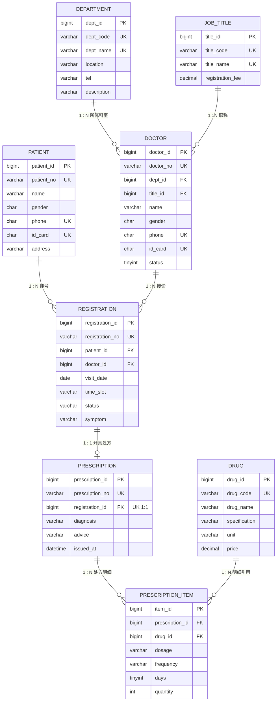

# 实验二：医疗系统数据库设计与基础 CRUD

## 一、实验目的与环境

**实验目的**：设计符合第三范式的医疗多实体数据库；使用 MyBatis-Plus 代码生成器一键生成持久层；实现科室、医生、患者的多条件组合分页查询与增删改；用 PreparedStatement 防止 SQL 注入；对手机号、身份证等医疗敏感字段做格式校验。

| 项目 | 版本 / 说明 |
| --- | --- |
| JDK | LibericaJDK 17 |
| Spring Boot | 3.2.0 |
| MyBatis-Plus | 3.5.12（starter / generator） |
| MySQL | 8.0.45，库 `medical_db`（InnoDB / utf8mb4_unicode_ci） |
| 模板引擎 | velocity-engine-core 2.3（代码生成器） |
| 前端 | Vue 3 + Vite（5173，本实验不改动） |

## 二、数据库设计（第三范式）

### 2.1 实体关系图（ER 图）



关系说明：一个科室有多名医生；一种职称对应多名医生（挂号费只与职称有关）；一名医生可接诊多条挂号、一名患者可挂多个号；一次挂号最多开一张处方（`registration_id` 唯一）；一张处方包含多条药品明细；一种药品可出现在多张处方明细中。

### 2.2 表结构与约束

| 表 | 主键 | 非空列数 | 唯一约束 | 外键 |
| --- | --- | --- | --- | --- |
| `department` | `dept_id` (BIGINT AUTO_INCREMENT) | 7 | `dept_code`、`dept_name` | — |
| `job_title` | `title_id` | 4 | `title_code`、`title_name` | — |
| `drug` | `drug_id` | 6 | `drug_code` | — |
| `doctor` | `doctor_id` | 11 | `doctor_no`、`phone`、`id_card` | `dept_id → department`、`title_id → job_title` |
| `patient` | `patient_id` | 8 | `patient_no`、`phone`、`id_card` | — |
| `registration` | `registration_id` | 9 | `registration_no`、(`doctor_id`,`visit_date`,`time_slot`) | `patient_id → patient`、`doctor_id → doctor` |
| `prescription` | `prescription_id` | 7 | `prescription_no`、`registration_id`(1:1) | `registration_id → registration` |
| `prescription_item` | `item_id` | 7 | (`prescription_id`,`drug_id`) | `prescription_id → prescription`(CASCADE)、`drug_id → drug` |

所有外键默认 `ON DELETE RESTRICT ON UPDATE CASCADE`，只有处方明细随处方 `CASCADE` 删除；为 `doctor.dept_id/title_id/name`、`patient.name`、`registration.patient_id/visit_date`、`prescription_item.drug_id` 建立普通索引。时间戳由 `DEFAULT CURRENT_TIMESTAMP`、`ON UPDATE CURRENT_TIMESTAMP` 在数据库侧维护。另有 13 个 CHECK 约束，覆盖性别取值、在诊状态、手机号与身份证正则、用药天数/数量大于 0、时段与挂号状态枚举、挂号费与药品价格非负。

### 2.3 第三范式论证

- **1NF**：全部字段为原子值（地址是单一字符串、性别存单字符 `M/F`），一张处方含多种药品时用独立的 `prescription_item` 子表存储，处方表中不出现“药品1/药品2”这类重复组。
- **2NF**：全部表使用单列自增代理主键，非主属性完全函数依赖于主键，不存在只依赖主键一部分的属性。
- **3NF**：消除非主属性之间的传递依赖，本设计刻意去掉了这些冗余：
  1. `doctor` 不存科室名称、职称名称、挂号费。挂号费由职称决定，若放到医生表就形成 `doctor_id → title_id → registration_fee` 的传递依赖，因此独立出 `job_title` 字典表，医生只保留 `title_id`。
  2. `registration` 不存 `dept_id`、患者姓名、医生姓名、挂号费。这些都可以由 `doctor_id → doctor.dept_id / title_id` 推导；若冗余存储，换科室或调价时会出现数据不一致。
  3. `prescription` 不存 `patient_id`、`doctor_id`、`dept_id`，均可由 `registration_id` 关联得到。
  4. `department` 不存医生人数等统计派生字段，统计值用 `COUNT` 实时计算。
  5. `prescription_item` 只存 `drug_id` 与剂量信息，不冗余药品名称、规格、单价，避免处方固化历史价格造成多表不一致。

结论：8 张表无冗余字段，全部满足 3NF。第 6、7 节的两条关联还原查询（挂号单 → 患者/医生/科室/职称/挂号费；处方 → 明细 → 药品）证明所有被消除的冗余信息都能通过外键 JOIN 完整还原。

### 2.4 建表脚本与执行

完整可执行脚本为 `sql/medical_db.sql`（建库 + 按外键逆序 DROP/CREATE），初始化数据为 `sql/02_init_data.sql`，约束核验为 `sql/03_verify_constraints.sql`。三者已在本机 MySQL 8.0.45 实测：连续执行两次均 **0 报错**，脚本可重复执行。

```powershell
$mysql = "C:\Program Files\MySQL\MySQL Server 8.0\bin\mysql.exe"
$env:MYSQL_PWD = "123456"
Get-Content sql\medical_db.sql   -Raw -Encoding UTF8 | & $mysql -uroot --default-character-set=utf8mb4
Get-Content sql\02_init_data.sql -Raw -Encoding UTF8 | & $mysql -uroot --default-character-set=utf8mb4
Get-Content sql\03_verify_constraints.sql -Raw -Encoding UTF8 | & $mysql -uroot --default-character-set=utf8mb4
```

约束核验输出（`03_verify_constraints.sql` 的实际结果，节选）：

| 检查项 | 结果 |
| --- | --- |
| 数据表清单 | 8 张表全部 InnoDB + utf8mb4_unicode_ci，中文表注释正常显示 |
| 主键 / 非空 | 每张表 `pk_count = 1`，非空列数与 2.2 节一致 |
| 唯一索引 | 16 个唯一索引（含 3 个单列唯一、2 个复合唯一）全部生效 |
| 外键 | 7 条外键，`DELETE_RULE` 除明细表为 CASCADE 外均为 RESTRICT |
| CHECK | 13 条 CHECK 约束全部创建成功（MySQL 8.0 真正执行 CHECK） |
| 关联还原 | 挂号单 JOIN 出患者、医生、科室、职称与挂号费；处方 JOIN 出明细与药品规格单价 |

## 三、MyBatis 配置与代码生成器

### 3.1 持久层配置（`application.properties`）

```properties
spring.datasource.url=jdbc:mysql://localhost:3306/medical_db?useUnicode=true&characterEncoding=UTF-8&serverTimezone=Asia/Shanghai&useSSL=false&allowPublicKeyRetrieval=true
spring.datasource.username=root
spring.datasource.password=123456

mybatis-plus.mapper-locations=classpath:mapper/*.xml
mybatis-plus.configuration.map-underscore-to-camel-case=true
mybatis-plus.global-config.db-config.id-type=auto

logging.level.com.example.test1.mapper=debug
```

`mapper-locations` 让 Mapper XML 与接口按 `classpath:mapper/*.xml` + 接口全限定名自动绑定；`map-underscore-to-camel-case` 完成 `dept_id → deptId` 列名映射；`id-type=auto` 与自增主键一致，插入后主键回填到实体；Mapper 包通过启动类上的 `@MapperScan("com.example.test1.mapper")` 注册，无需每个接口写 `@Mapper`。

### 3.2 MyBatis-Plus 代码生成器

配置类：`src/main/java/com/example/test1/generator/CodeGenerator.java`。

```java
FastAutoGenerator.create(URL, USERNAME, PASSWORD)
    .globalConfig(b -> b.author("student").outputDir(outputDir + "/src/main/java")
            .commentDate("").disableOpenDir())
    .packageConfig(b -> b.parent("com.example.test1")
            .entity("entity").mapper("mapper").service("service").serviceImpl("service.impl")
            .xml("mapper")
            .pathInfo(Collections.singletonMap(OutputFile.xml, outputDir + "/src/main/resources/mapper")))
    .strategyConfig(b -> {
        b.addInclude("department", "job_title", "drug", "doctor", "patient",
                     "registration", "prescription", "prescription_item")
         .entityBuilder().idType(IdType.AUTO).enableTableFieldAnnotation()
             .naming(NamingStrategy.underline_to_camel)
             .columnNaming(NamingStrategy.underline_to_camel);
        b.controllerBuilder().disable();
    })
    .execute();
```

运行命令：

```powershell
.\mvnw.cmd -q org.codehaus.mojo:exec-maven-plugin:3.3.0:java "-Dexec.mainClass=com.example.test1.generator.CodeGenerator"
```

实际运行结果：一次生成 **8 张表 × (entity + mapper 接口 + IService + ServiceImpl + Mapper.xml) = 40 个文件**，输出到 `target/generated-mp/`。设计上的两点取舍：

1. `controllerBuilder().disable()`：控制器要承载分页参数校验、外键存在性判断、唯一性预检等业务逻辑，通用模板生成不出这些内容。
2. 输出到 `target/generated-mp/` 而不是直接覆盖 `src/main/java`：生成器用于“一键生成骨架、避免重复编码”，但实体需要补充中文注释、Mapper 接口需要补充多条件分页方法，这些人工增强不应在每次生成时被覆盖。生成结果对照后人工同步到源码目录，源码中 8 个实体均保留了生成器的 `@TableName/@TableId/@TableField` 注解风格。

## 四、CRUD 与多条件分页实现

### 4.1 接口清单（统一前缀 `/api`，统一响应 `R<T>`）

| 资源 | 分页（多条件） | 详情 | 新增 | 修改 | 删除 |
| --- | --- | --- | --- | --- | --- |
| 科室 | `GET /api/departments` | `GET /{id}` | `POST` | `PUT /{id}` | `DELETE /{id}` |
| 医生 | `GET /api/doctors` | `GET /{id}` | `POST` | `PUT /{id}` | `DELETE /{id}` |
| 患者 | `GET /api/patients` | `GET /{id}` | `POST` | `PUT /{id}` | `DELETE /{id}` |

另有 `GET /api/departments/titles` 返回职称字典，供医生表单下拉选择。

多条件组合：

| 资源 | 模糊匹配 | 精确匹配 |
| --- | --- | --- |
| 科室 | `deptName`、`location` | `tel` |
| 医生 | `name` | `deptId`、`titleId`、`phone`、`idCard`、`gender`、`status` |
| 患者 | `name` | `phone`、`idCard`、`gender` |

### 4.2 分层与调用链

`Controller`（参数绑定、分页参数校验、去空格）→ `IService/ServiceImpl`（业务校验、唯一性预检、外键存在性检查、删除前引用检查）→ `Mapper`（MyBatis-Plus `BaseMapper` 通用方法 + XML 中的多条件分页 SQL）。

- 新增、修改、删除、详情、单条件查询走 `BaseMapper` / `IService` 通用方法（被生成的 `ServiceImpl` 直接复用）；
- 多条件组合分页走 `Mapper.xml` 中的 `<where> + <if>` 动态 SQL，避免用 `QueryWrapper` 字符串拼接条件。

### 4.3 分页与预编译

分页采用「一次 COUNT + 一次 LIMIT 查询」，两次 SQL 的条件片段完全一致（抽成 `<sql id="...Where">` 复用）：

```xml
<sql id="doctorWhere">
    <where>
        <if test="name != null and name != ''">   AND name LIKE CONCAT('%', #{name}, '%') ESCAPE '!' </if>
        <if test="deptId != null">                AND dept_id = #{deptId}                </if>
        <if test="titleId != null">               AND title_id = #{titleId}              </if>
        <if test="phone != null and phone != ''"> AND phone = #{phone}                   </if>
        <if test="idCard != null and idCard != ''"> AND id_card = #{idCard}              </if>
        <if test="gender != null and gender != ''"> AND gender = #{gender}               </if>
        <if test="status != null">                AND status = #{status}                 </if>
    </where>
</sql>

<select id="countByCondition" resultType="long">
    SELECT COUNT(*) FROM doctor <include refid="doctorWhere"/>
</select>

<select id="selectByCondition" resultType="com.example.test1.entity.Doctor">
    SELECT doctor_id, doctor_no, dept_id, title_id, name, gender, phone, id_card,
           status, created_at, updated_at
    FROM doctor <include refid="doctorWhere"/>
    ORDER BY doctor_id ASC
    LIMIT #{offset}, #{size}
</select>
```

`offset = (page - 1) * size` 由 `PageParam` 在服务端计算，并校验 `1 <= page <= 1000000`、`1 <= size <= 100`（页码上限防止 `(page-1)*size` 溢出成负数导致 `LIMIT` 语法错误）；`PageResult<T>` 返回 `records / total / page / size / pages`。若 `offset >= total`（页码越界），Service 直接返回空列表，不再执行分页 SQL。SQL 的 `LIMIT` 参数同样使用 `#{offset}, #{size}` 预编译占位符，而不是字符串拼接（MyBatis-Plus 3.5.12 的 `PaginationInnerInterceptor` 位于额外依赖 `mybatis-plus-jsqlparser`，本项目未引入，因此采用显式 LIMIT 实现，可控性更强）。

#### 模糊查询通配符转义

用户输入 `%` 或 `_` 时若直接拼进 `LIKE`，会被当成通配符：搜索「张_」会命中所有张姓、搜索「%」会命中全表。为此新增 `common/SqlLikeUtil`，在 Service 层对关键字做转义，并在 Mapper 中声明 `ESCAPE '!'`：

```java
// SqlLikeUtil：转义 LIKE 特殊字符
public static String escape(String keyword) {
    if (keyword == null) return null;
    String trimmed = keyword.trim();
    if (trimmed.isEmpty()) return null;          // 空关键字 = 不加该条件
    StringBuilder sb = new StringBuilder();
    for (char c : trimmed.toCharArray()) {
        if (c == '!' || c == '%' || c == '_') sb.append('!');
        sb.append(c);
    }
    return sb.toString();
}
```

**转义字符为什么用 `!` 而不是反斜杠**：MySQL 的字符串字面量中反斜杠本身是转义符，SQL 里写 `ESCAPE '\'` 会被解析成非法转义序列（实测直接返回 HTTP 500）。改用 `!` 后在任何 `sql_mode` 下都无需二次转义，与 XML 中的 `ESCAPE '!'` 严格一致。

实测：`deptName=%` 与 `name=_` 均返回 `total: 0`（按字面匹配），正常关键字 `内` 仍正确命中 1 条。

## 五、PreparedStatement 防 SQL 注入

- **机制**：MyBatis 的 `#{...}` 会被编译成 JDBC `?` 占位符，SQL 文本先由数据库预编译，参数随后单独绑定，参数值中的引号、注释符、逻辑运算符只会被当作**数据**，不会改变 SQL 语法树。本实验所有动态条件、模糊匹配通配符和 `LIMIT` 参数全部使用 `#{}`，没有使用 `${}`，也没有使用 `QueryWrapper.last()` 拼接原始 SQL 片段。
- **对比**：若写成 `LIKE '%${name}%'` 或用字符串拼接 `LIMIT`，攻击者输入 `' OR '1'='1` 就会闭合引号并追加恒真条件，导致全表泄露、越权删除甚至拖库。
- **实测（T34–T38）**：

| 用例 | 请求 | 结果 |
| --- | --- | --- |
| T34 | `/api/departments?deptName=' OR '1'='1` | HTTP 200，`total: 0`，注入串被当作普通字面量 |
| T35 | `/api/doctors?name=%' OR 1=1 -- ` | HTTP 200，`total: 0` |
| T36 | `/api/patients?phone=1' UNION SELECT * FROM mysql.user -- ` | HTTP 200，`total: 0` |
| T37 | `DELETE /api/departments/1 OR 1=1` | HTTP 400（路径变量类型不匹配），数据未删除 |
| T38 | 注入后再查科室 | 仍为 7 条，数据完好 |

- **分层兜底**：`GlobalExceptionHandler` 把业务校验、参数类型错误、非法 JSON、唯一键冲突、完整性约束冲突分别映射为 HTTP 400 / 409，统一返回 `R{code,message,data}`，不向前端暴露堆栈与 SQL 细节。

## 六、敏感字段格式校验

| 字段 | 规则 | 实现 |
| --- | --- | --- |
| 医生/患者手机号 | `^1[3-9]\d{9}$` | `FieldValidator.phone` |
| 身份证号格式 | 18 位：6 位地区码 + 8 位出生日期 + 3 位顺序码 + 1 位校验位 | `FieldValidator.idCard` |
| 身份证出生日期 | `yyyyMMdd` 必须是真实日期（1992-02-30 拒绝） | `LocalDate.parse(..., BASIC_ISO_DATE)` |
| 身份证校验位 | ISO 7064 MOD 11-2：前 17 位加权求和，模 11 映射到 `10X98765432` | 权重表 + 校验码表 |
| 性别 | 只能 `M` / `F`，与数据库 CHECK 一致 | `FieldValidator.gender` |
| 科室联系电话 | `^[0-9][0-9\-]{6,19}$` | `FieldValidator.officePhone` |
| 必填与关联 | 姓名、工号、科室编码、位置非空；`deptId`/`titleId` 存在性 | `notBlank` / `getById` |
| 唯一性 | 工号、手机号、身份证号、科室编码/名称预检 | `LambdaQueryWrapper` 计数，排除自身 |
| 地址长度 | 不超过 200 字符 | `FieldValidator.maxLength` |
| 分页参数 | `page >= 1`，`1 <= size <= 100` | `PageParam` |
| 数据库层 | `UNIQUE`、`FOREIGN KEY ... RESTRICT`、13 条 `CHECK` | DDL 约束，冲突映射 HTTP 409 |

校验放在写接口入口（Service 的 `validate` + `checkUnique` + `checkForeignKey`），失败抛 `BizException` 返回友好提示，不让脏数据落到数据库后再报错。

### 工程价值

应用层校验负责“快速反馈、友好提示”，数据库约束负责“最后防线、并发下仍然成立”。身份证校验位能发现绝大多数输入/录入错误；唯一约束防止同一患者重复建档；删除医生/科室前的引用检查（配合外键 RESTRICT）防止误删导致挂号记录悬空。医疗数据一旦出错会直接影响挂号、处方与费用结算，两层校验共同构成数据质量保障。

## 七、测试记录

测试脚本：`scripts/api_test.ps1`（PowerShell，Windows PowerShell 5.1 可直接运行），执行前先重置 `medical_db` 并启动后端。

```powershell
powershell -NoProfile -ExecutionPolicy Bypass -File scripts\api_test.ps1
```

**实际运行结果：38 项全部通过（通过 38 项，失败 0 项）**。

| 编号 | 用例 | 预期 | 结果 |
| --- | --- | --- | --- |
| T01 | 科室分页 `page=1&size=3` | total=6, 3 条, pages=2 | 通过 |
| T02 | 科室名称模糊查询 | total=1（内科） | 通过 |
| T03 | 科室位置模糊 + 电话精确 | total=1（D002） | 通过 |
| T04 | 医生 科室+性别+状态 组合 | 记录全部满足条件 | 通过 |
| T05 | 医生姓名模糊查询 | 命中刘雅琴 | 通过 |
| T06 | 医生 科室+职称 组合 | total=1（张建国） | 通过 |
| T07 | 患者手机号精确查询 | total=1（罗俊） | 通过 |
| T08 | 患者性别+姓名模糊 | 记录全部为 F | 通过 |
| T09 | 分页越界 `page=99` | 空列表，total 不变 | 通过 |
| T10 | 新增科室 D007 | code=200，返回自增主键 | 通过 |
| T11 | 修改科室电话 | tel 已更新 | 通过 |
| T12 | 新增医生（合法身份证/手机号） | code=200 | 通过 |
| T13 | 修改医生职称与状态 | titleId=2, status=0 | 通过 |
| T14 | 新增患者 | 自动生成就诊卡号 `P...` | 通过 |
| T15 | 修改患者地址 | address 已更新 | 通过 |
| T16–T17 | 删除无挂号记录的患者并复查 | code=200，total=0 | 通过 |
| T18 | 删除有挂号记录的医生 | HTTP 400「存在 2 条挂号记录」 | 通过 |
| T19 | 删除有医生的科室 | HTTP 400「仍有 3 名医生」 | 通过 |
| T20 | 手机号 `123` | HTTP 400 | 通过 |
| T21 | 身份证校验位错误 | HTTP 400「校验位不正确」 | 通过 |
| T22 | 身份证出生日期 1992-02-30 | HTTP 400「出生日期不合法」 | 通过 |
| T23 | 身份证 17 位 | HTTP 400 | 通过 |
| T24 | 姓名为空白 | HTTP 400 | 通过 |
| T25 | 性别 `X` | HTTP 400 | 通过 |
| T26 | `size=1000` | HTTP 400 分页参数被拒绝 | 通过 |
| T27 | `page=0` | HTTP 400 | 通过 |
| T28 | 科室电话 `abc` | HTTP 400 | 通过 |
| T29 | 重复手机号 | HTTP 400 已存在 | 通过 |
| T30 | 重复身份证号 | HTTP 400 已存在 | 通过 |
| T31 | 重复科室名称 | HTTP 400 已存在 | 通过 |
| T32 | 医生 `deptId=99` | HTTP 400 科室不存在 | 通过 |
| T33 | 医生 `titleId=99` | HTTP 400 职称不存在 | 通过 |
| T34–T38 | SQL 注入 5 项 | 见第五节 | 通过 |

### 7.2 单元测试（`FieldValidatorTest`，不依赖 Spring / 数据库）

| 测试组 | 用例数 | 覆盖内容 | 结果 |
| --- | --- | --- | --- |
| 手机号 | 9 | 合法号段通过；`123`、`128...`、位数不足/超长、含字母被拒绝 | 通过 |
| 身份证 | 10 | 合法号码（含小写 `x`）通过；校验位错误、2 月 30 日、位数错误、地区码以 0 开头、月份/日期非法被拒绝 | 通过 |
| 性别 / 电话 / 空值 / 长度 | 8 | 性别仅 `M`/`F`；固话数字与连字符；null/空串/空白判空；超长字段拒绝 | 通过 |
| LIKE 转义 | 4 | `%` `_` `!` 转义为字面量；空关键字返回 null；反斜杠原样保留 | 通过 |

执行结果：`Tests run: 32, Failures: 0, Errors: 0`（31 项单元测试 + 1 项 `@SpringBootTest` 上下文加载）。

### 7.3 修复过的回归缺陷

| 问题 | 现象 | 原因与修复 |
| --- | --- | --- |
| `pom.xml` 混入 JUnit 4 | JUnit 4.13.2 与 JUnit 5.10.1 并存 | 显式移除 `junit:junit`，仅保留 `spring-boot-starter-test`（已含 JUnit 5） |
| `ESCAPE '\'` 语法错误 | 所有模糊查询返回 HTTP 500 | MySQL 字符串字面量中反斜杠是转义符，`'\'` 被解析成非法转义；改为 `ESCAPE '!'` |
| 空字段无法清空 | `PUT` 传 `address: null` 不生效 | MyBatis-Plus `updateById` 默认忽略 null 字段；改用 `UpdateWrapper` 显式 `set` |
| 身份证大小写不一致 | 同一人末位 `x`/`X` 被当成两个值，唯一索引失效 | 写库前统一 `toUpperCase()`，并去首尾空格 |
| 页码溢出 | 极大 `page` 使 `(page-1)*size` 溢出为负数，`LIMIT` 报错 | `PageParam` 增加页码上限 1000000 |
| `@Select` 注解散落 | `StatusMapper` 的 SQL 不在 XML 中 | 迁移到 `resources/mapper/StatusMapper.xml` |
| Controller 重复判空 | 每个 `get` 接口重复 `new BizException` | 下沉为 Service 的 `getRequired(id)` |

## 八、附件清单

| 附件 | 路径 |
| --- | --- |
| 实验报告 | `docs/实验报告.md` |
| 完整可执行建表 SQL | `sql/medical_db.sql` |
| 初始化数据 / 约束核验 SQL | `sql/02_init_data.sql`、`sql/03_verify_constraints.sql` |
| 代码生成器 | `src/main/java/com/example/test1/generator/CodeGenerator.java` |
| 持久层 | `entity/`（8 个）、`mapper/`（8 个 + 健康检查 `StatusMapper`）、`service/`、`service/impl/`、`resources/mapper/`（8 个 XML） |
| CRUD 控制器 | `controller/DepartmentController.java`、`DoctorController.java`、`PatientController.java` |
| 公共层 | `common/R.java`、`PageResult.java`、`FieldValidator.java`、`BizException.java`、`GlobalExceptionHandler.java`、`SqlLikeUtil.java`、`controller/PageParam.java` |
| 跨域配置 | `config/WebConfig.java`（允许 GET/POST/PUT/DELETE） |
| 单元测试 | `src/test/java/com/example/test1/common/FieldValidatorTest.java`（31 项） |
| 配置 | `pom.xml`、`src/main/resources/application.properties` |
| 接口回归测试 | `scripts/api_test.ps1`（38 项） |

## 九、运行步骤

```powershell
# 1. 建库建表 + 初始化数据（PowerShell 不支持 < 输入重定向，改为读取文件后管道执行）
$mysql = "C:\Program Files\MySQL\MySQL Server 8.0\bin\mysql.exe"
$env:MYSQL_PWD = "123456"
Get-Content sql\medical_db.sql   -Raw -Encoding UTF8 | & $mysql -uroot --default-character-set=utf8mb4
Get-Content sql\02_init_data.sql -Raw -Encoding UTF8 | & $mysql -uroot --default-character-set=utf8mb4

# 2. 启动后端（8080）
$env:JAVA_HOME = "C:\Program Files\Java\LibericaJDK-17"
.\mvnw.cmd spring-boot:run

# 3. 接口示例
# GET    http://localhost:8080/api/doctors?page=1&size=10&deptId=1&status=1
# POST   http://localhost:8080/api/doctors   (JSON: doctorNo, deptId, titleId, name, gender, phone, idCard, status)
# PUT    http://localhost:8080/api/doctors/1
# DELETE http://localhost:8080/api/departments/7

# 4. 回归测试
powershell -NoProfile -ExecutionPolicy Bypass -File scripts\api_test.ps1
```

前端 Vue（5173）通过 Vite 代理 `/api` 到 8080，`WebConfig` 同时放开了 PUT/DELETE 的跨域方法，本实验未改动前端代码。
